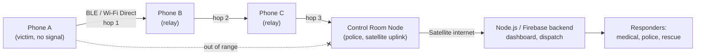

# Technical Design Document

## 1. Problem
Dense crowds saturate cell towers. Calls, SMS and data fail exactly when a stampede, medical emergency or missing child occurs. Responders get no signal.

## 2. Architecture



ASCII version of the hop path:

```
 [Phone A] ---hop1---> [Phone B] ---hop2---> [Phone C] ---hop3---> [Control Room] ==satellite==> [Backend]
   SOS                  relay                  relay               decrypts + displays
   (encrypted)       (cannot read)          (cannot read)
```

## 3. Components

| Component | Technology | Role |
|---|---|---|
| Mobile app | React Native | One-tap SOS, Lost Person beacon, relay service |
| Mesh transport | Google Nearby Connections API (BLE + Wi-Fi Direct), strategy `P2P_CLUSTER` | Peer discovery and payload exchange |
| Routing logic | `src/mesh.js` (this repo) | Flooding with dedupe, TTL, store-and-forward |
| Control-room node | Phone/tablet with satellite or wired uplink | Gateway: decrypt, verify, forward |
| Backend | Node.js + Firebase (control room only) | Dashboard, dispatch, alert history |

## 4. Packet format

```json
{
  "id": "uuid-v4",
  "type": "SOS | LOST_PERSON",
  "origin": "device id",
  "ttl": 8,
  "hops": 0,
  "path": ["origin"],
  "box": { "iv": "...", "tag": "...", "ct": "..." }
}
```

`box` holds the AES-256-GCM encrypted payload (location, note, name/age for lost persons, timestamp). Relays see only the routing header.

## 5. Routing algorithm (controlled flooding with store-and-forward)

1. Originate: create packet, add ID to `seen`, store it.
2. For each stored packet, send once to each neighbour in range (track `sent[packetId]` so late-arriving neighbours still get it).
3. On receive: if ID in `seen`, drop. Otherwise add to `seen`, decrement TTL, increment hops, append own ID to `path`.
4. If the receiver is the gateway: decrypt and verify, push to the control-room inbox. Failure (tamper or wrong key) increments `rejected`.
5. Otherwise store for forwarding if TTL is still above 0.

Properties: loop-free (dedupe), bounded (TTL, store cap of 100), tolerant of partitions (store-and-forward), duplicate routes cost bandwidth but not correctness.

## 6. Security

- Payload confidentiality and integrity: AES-256-GCM; any modification by a relay is detected at the gateway (tested).
- Demo uses a shared secret. **Production:** each phone seals the payload to the control room's public key so a captured phone cannot decrypt others' alerts.
- Limitations still to address: spam and flooding (rate limiting, signed device registration), location privacy of relays, battery cost of continuous advertising.

## 7. Mobile integration

The protocol maps directly onto Nearby Connections:

| Nearby Connections event | Calls into `mesh.js` |
|---|---|
| `onPayloadReceived(endpointId, payload)` | `node.receive(JSON.parse(payload))` |
| `onConnectionResult` / new endpoint | tick: offer stored packets to the new peer |
| SOS button | `node.originate('SOS', {...})` |
| Lost Person beacon | `node.originate('LOST_PERSON', {...})` |

## 8. Test cases (`test/mesh.test.js`)

1. Multi-hop delivery A to B to C to control room, exact path and hop count.
2. Duplicate routes deliver exactly once.
3. TTL expiry stops forwarding.
4. Partition: no delivery while out of range; delivered when a link appears (store-and-forward).
5. Tampered packet rejected at the gateway.
6. Relay cannot read the payload.
7. Unknown packet type rejected.

## 9. Impact
Alerts reach responders without any SIM or cell coverage, shortening response time and letting families locate missing children during crowd events.
